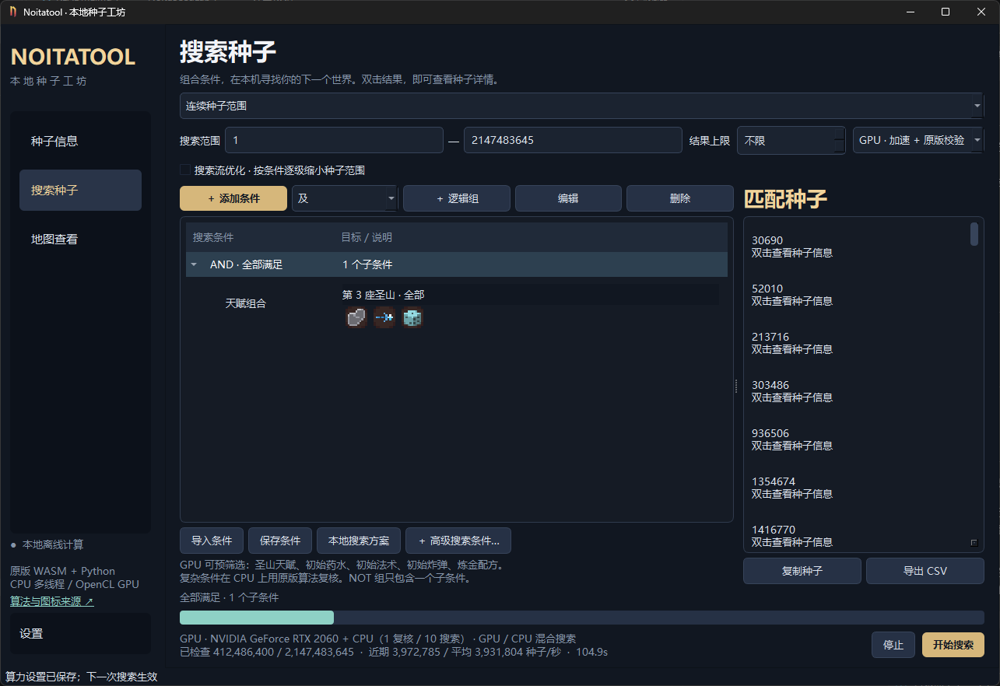
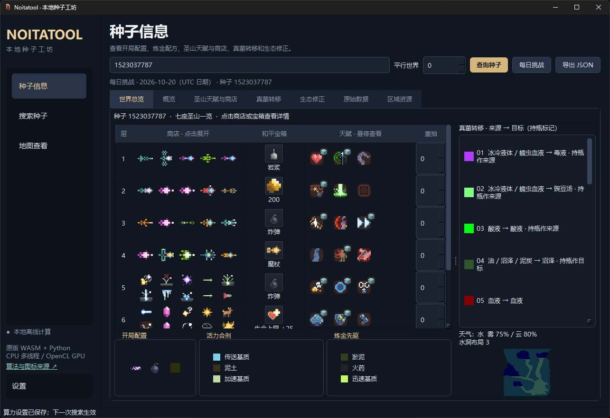
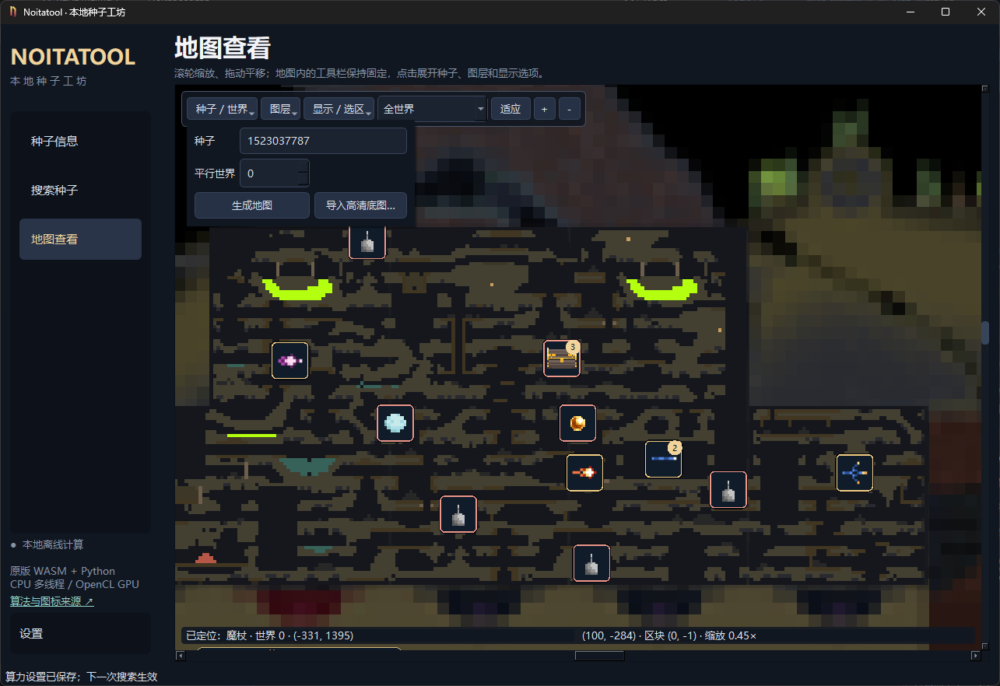

# NoitaSeedLab

>还在为了找种子而四处晕头转向吗！还在因为地图上还有哪些东西没找到而气馁吗！快来使用本软件吧

||终究是因为找不到种子而急急急了||

## 能做什么

- **查种子**：查看开局物品、圣山天赋与商店、炼金配方、真菌转移等信息，支持天赋重抽和平行世界查询。
- **找种子**：按天赋、法术、魔杖属性、配方等组合筛选，也可以指定区域查找法术。支持搜索种子范围，或导入已有列表继续筛选。
- **看地图**：缩放、拖动和框选区域，查看魔杖、法术、宝箱、魔球、石板等资源位置；也能导入自己的高清地图。

搜索支持 CPU 和 GPU 加速 

## 算法来源

[Noitool / noita-tools](https://github.com/TwoAbove/noita-tools) 和 [Noita Telescope](https://github.com/Lymm37/noita-telescope) 
十分感谢两位大佬开源的项目

## 界面预览

## 搜索能力

本人2060笔记本在GPU加速的情况下可以实现在600s以内完成平均在3984199种子/秒，而纯CPU则只有30712种子每秒，做到一百倍的差距，而其也只需要一个线程回来做简单验证即可。

](docx/findseedloder.png)

## 下载与使用

Windows 打包版发布后，可在本仓库的 **Releases** 页面下载。
Linux、mac由于本人没有那些系统的电脑不知道兼容情况所以推荐直接使用源码通过 **main.py** 使用

1. 下载并解压完整压缩包，打开 `NoitaSeedLab.exe`，无需另装运行环境。
2. 在「种子信息」输入种子查询，或在「搜索种子」添加条件后开始搜索。
3. 想查看资源位置时，进入「地图查看」并输入种子。

请保留解压后的整个文件夹。设置、搜索方案和缓存保存在程序旁的 `data` 文件夹，更新版本时将它一并保留即可。GPU 搜索需要显卡与驱动支持，无法使用时可选择 CPU。

> 预测结果仅供参考，以游戏内实际情况为准。

## 致谢

再次十分感谢 [Noitool / noita-tools](https://github.com/TwoAbove/noita-tools) 和 [Noita Telescope](https://github.com/Lymm37/noita-telescope) 提供的算法与游戏资源。第三方来源与许可见 [THIRD_PARTY.md](THIRD_PARTY.md)。
