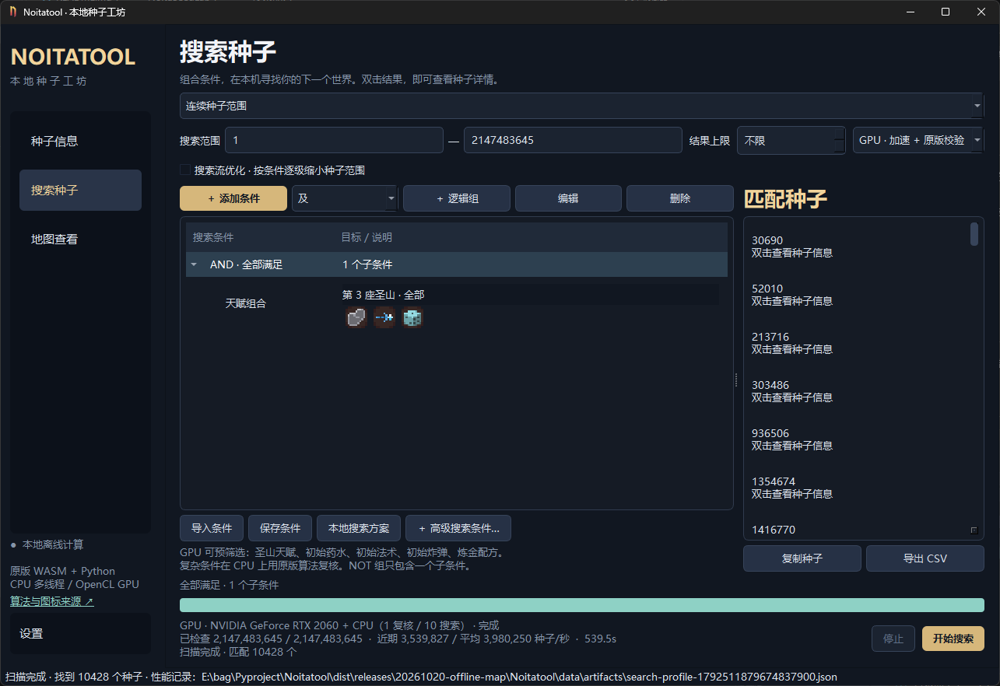

<h1 align="center">NoitaSeedLab</h1>

  <a href="./README_EN.md">English</a>
  &nbsp; | &nbsp;
  <a href="./README.md">简体中文</a>

## Features

- **Seed Lookup**: View starting items, Holy Mountain perks and shops, alchemy recipes, fungal shifts, and more. Supports perk rerolls and parallel world queries.
- **Seed Search**: Combine filters for perks, spells, wand stats, recipes, and more. You can also search for spells within specific regions. Search a seed range or import an existing seed list for further filtering.
- **Map Viewer**: Zoom, pan, and select regions to locate wands, spells, chests, orbs, tablets, and other resources. You can also import your own high-resolution maps.

Seed searches support both CPU and GPU acceleration.

## Algorithm Sources

Algorithms are based on [Noitool / noita-tools](https://github.com/TwoAbove/noita-tools) and [Noita Telescope](https://github.com/Lymm37/noita-telescope).

Huge thanks to the creators of both projects for making their work open source!

## Screenshots

## Search Performance

On my laptop with an RTX 2060, a GPU-accelerated search benchmark completed in under 600 seconds, averaging **3,984,199 seeds per second**. CPU-only searching averaged **30,712 seeds per second**, making GPU acceleration approximately **130 times faster** in this benchmark.

GPU searching requires only a single CPU thread for basic result validation.

## Language Support

The application includes English and Chinese by default. Other languages require community-made translations.

The localization system supports CSV, JSON, and other translation formats. Translation contributions are welcome to help bring the application to more languages.

## Download and Usage

Once a packaged Windows build is available, you can download it from this repository's **Releases** page.

Linux and macOS compatibility has not been tested, as I do not have access to computers running those systems. For those platforms, running the application from source via **main.py** is recommended.

1. Download and extract the complete archive, then launch `NoitaSeedLab.exe`. No separate runtime installation is required.
2. Enter a seed in **Seed Information** to look it up, or add filters in **Seed Search** and start searching.
3. To locate resources, open **Map Viewer** and enter a seed.

Keep the entire extracted folder intact. Settings, search presets, and caches are stored in the `data` folder next to the application. Preserve this folder when updating to a new version.

GPU searching requires a compatible graphics card and driver. If GPU acceleration is unavailable, select CPU mode.

> Predictions are for reference only. Actual in-game results take precedence.

## Acknowledgments

Once again, huge thanks to [Noitool / noita-tools](https://github.com/TwoAbove/noita-tools) and [Noita Telescope](https://github.com/Lymm37/noita-telescope) for providing the algorithms and game resources.

See [THIRD_PARTY.md](THIRD_PARTY.md) for third-party sources and licenses.

***This project is not affiliated with 《Noita》 Games.***
